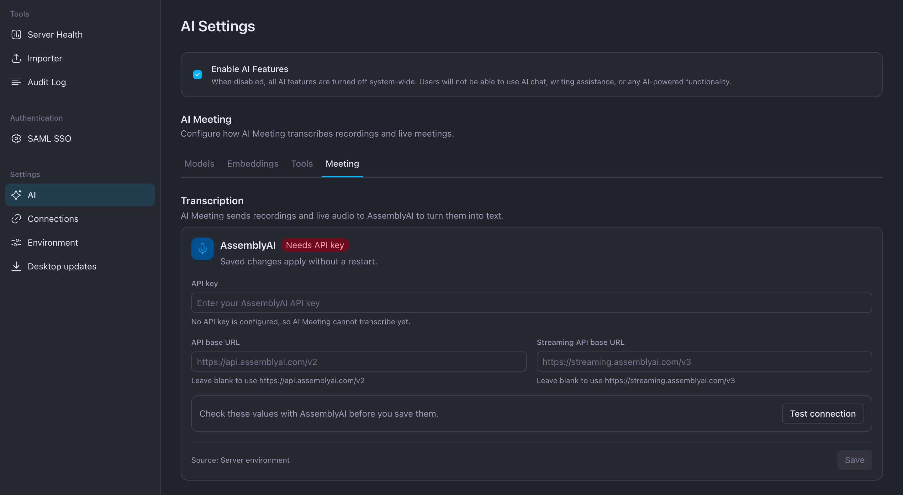
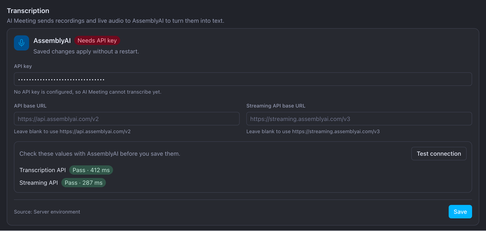
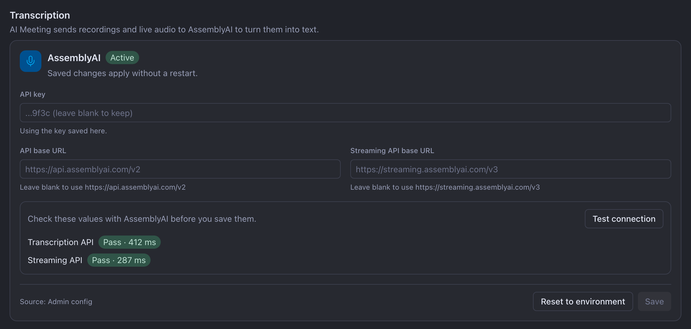
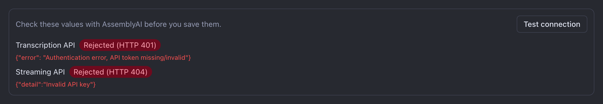

# Configure AI Meeting

[Documentation](README.md)

AI Meeting turns recordings and live meetings into text with [AssemblyAI](https://www.assemblyai.com/). To turn it on, add your AssemblyAI API key in **Admin → Settings → AI → Meeting**. Saved changes apply without restarting any service.

> **Already using `ASSEMBLYAI_API_KEY` in `.env`?** You do not need to change anything. The environment variables keep working, and the Meeting tab shows them as **Source: Server environment**. Use the tab only if you want to change the key or URLs without a restart.

## Before you begin

Make sure you have:

- An AssemblyAI API key. See [how to get your API key](https://www.assemblyai.com/docs/faq/how-to-get-your-api-key).
- A valid AppFlowy commercial license with AI enabled.
- `admin-frontend` and `appflowy-cloud` releases that include the **Meeting** tab. On earlier releases, [use environment variables](#use-environment-variables-instead).
- Outbound network access from `appflowy_cloud` to `api.assemblyai.com` and `streaming.assemblyai.com`.

## 1. Open the Meeting tab

Sign in to Admin as an administrator and open **Settings → AI**. Make sure **Enable AI Features** is on, then select the **Meeting** tab.

**Needs API key** means AI Meeting cannot transcribe yet.

## 2. Enter the API key and test it

Paste your key into **API key**, then select **Test connection**. The test saves nothing. It checks the two AssemblyAI services that AI Meeting uses:

- **Transcription API** for uploaded recordings.
- **Streaming API** for live meetings.

Both should show **Pass**.

Leave the two URL fields blank unless you need a [custom endpoint](#optional-use-a-custom-endpoint).

## 3. Save

Select **Save**. The card now shows **Active** and **Source: Admin config**.

AI Meeting can transcribe from now on. If you run several `appflowy_cloud` replicas, allow up to one minute for all of them to pick up the change.

Admin never shows the key again. It shows only the last four characters, so you can tell which key is in use.

## Change or remove the key

- **Replace the key:** type the new key and select **Save**. Leave the field blank to keep the current key.
- **Remove everything saved here:** select **Reset to environment** and confirm. AI Meeting then uses the environment variables again, or stops transcribing if none are set.

## Optional: use a custom endpoint

Fill in **API base URL** and **Streaming API base URL** only if you use a regional endpoint or a proxy. For example, AssemblyAI's EU API is `https://api.eu.assemblyai.com/v2`.

- Enter a full `http://` or `https://` URL, without a query string.
- When you change a URL to a different host, type the API key again. A saved key is never sent to a new host on its own.
- Run **Test connection** before you save.

## Use environment variables instead

You can also set AssemblyAI in `.env`. Both ways work together: a value saved in the Meeting tab takes priority, and any value you have not saved there comes from the environment.

| Variable | Default | Required |
| --- | --- | --- |
| `ASSEMBLYAI_API_KEY` | empty | Yes |
| `ASSEMBLYAI_API_BASE` | `https://api.assemblyai.com/v2` | No |
| `ASSEMBLYAI_STREAMING_API_BASE` | `https://streaming.assemblyai.com/v3` | No |

- Restart `appflowy_cloud` after changing them.
- Leave the two URL variables empty, or leave them out, to use the defaults.
- Docker Compose and Docker Swarm pass these variables to `appflowy_cloud`. The Helm chart does not, so use the Meeting tab on Kubernetes.
- The card's **Source** line tells you which one is in use. **Reset to environment** removes what was saved in Admin and returns to these variables.

## Import from YouTube

Importing a YouTube video into an AI Meeting block doesn’t work on self-hosted servers. AppFlowy Web first checks the workspace’s usage with an endpoint that self-hosted Cloud doesn’t provide, so the import fails before it contacts YouTube.

## Troubleshooting

| Problem | What to check |
| --- | --- |
| The **Meeting** tab is missing | Turn on **Enable AI Features**. If AI Settings itself is missing, check the commercial license. Otherwise upgrade `admin-frontend`. |
| "This AppFlowy Cloud version cannot change AI Meeting settings from Admin" | Upgrade `appflowy-cloud`, or use the environment variables. |
| The test shows **Rejected** | AssemblyAI did not accept the key. Copy the whole key again and confirm it is active in your AssemblyAI account. |
| The test shows **Could not connect** or **Timed out** | `appflowy_cloud` cannot reach the URL. Check the outbound firewall, proxy, and DNS. |
| The test shows **Not an AssemblyAI response** | The URL does not point at AssemblyAI. Check the base URL, including the `/v2` or `/v3` path. |
| "Enter the API key again to use it with a different host" | You changed a URL to a new host. Type the key, test, and save. |
| Users still cannot transcribe after you save | Run **Test connection** again, and wait one minute if you run several `appflowy_cloud` replicas. |

A rejected key looks like this. The red text is AssemblyAI's own answer:

