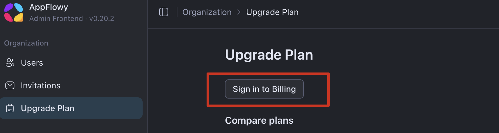
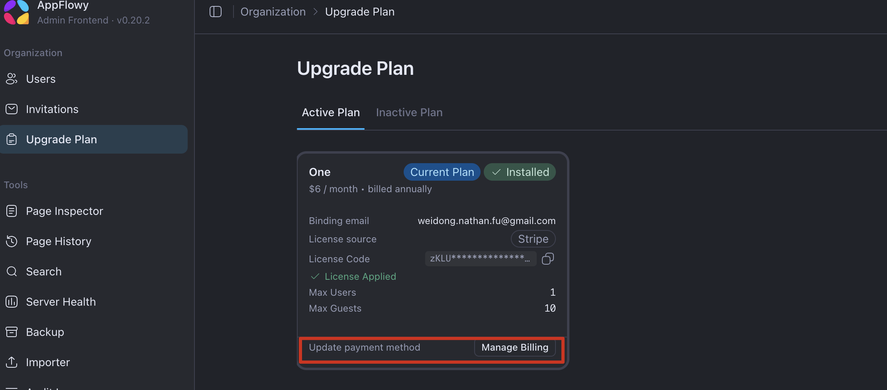
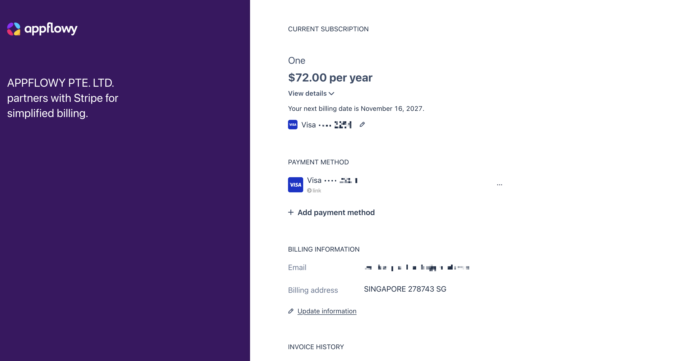

# Billing Q&A

## Billing Card

**How can I manage my billing card?**

1. Open your self-hosted AppFlowy admin frontend and go to
   `https://your-host/upgrade-plan`. Replace `your-host` with your instance's
   hostname.
2. If needed, click **Sign in to Billing** and complete sign-in.

   

3. Under **Active Plan**, click **Manage Billing** on your current Stripe plan.

   

4. The Stripe billing portal opens. Use the edit icon next to your subscription's
   card to update it, or select **Add payment method** under **Payment method**
   to add another card.

   
