# SCIM groups and permissions: an eight-person example

[Documentation](README.md) / [SCIM setup](SCIM.md) / [Entra setup](ENTRA_SCIM_AUTO_SYNC.md)

This example uses eight people, eight directory groups and three workspaces.
Each person starts in a different group, making their permissions easy to compare.

| Configure in | Purpose |
| --- | --- |
| Microsoft Entra ID | Choose each person's groups and application assignments |
| AppFlowy Admin | Receive groups in the correct workspace and map workspace roles |
| AppFlowy Web | Set each space's access and verify it as the affected person |

SCIM synchronizes users, group names and membership. Space permissions are
configured separately; creating a group does not create a space.

Some requested creation controls and group permissions still need implementation;
see [current limitations](#current-limitations).

**Baseline verified on October 12, 2026:** all eight people and nine workspace
groups are provisioned. All 72 Web access checks passed, with saved edits checked
independently. Charlie’s group move and restoration also passed, with his
account and saved notes retained.

## Contents

| Section | What you will do |
| --- | --- |
| [People and permissions](#people-and-permissions) | Understand the requested access |
| [1. Prepare the demo](#1-prepare-the-demo) | Check seats, sign-in and workspaces |
| [2. Connect Entra](#2-connect-entra) | Assign the eight groups to three applications |
| [3. Check synchronization](#3-check-synchronization) | Compare received groups and members |
| [4. Set space access](#4-set-space-access) | Give editor groups access to the right spaces |
| [5. Verify access](#5-verify-access) | Test View, Edit and denied direct links |
| [6. Move Charlie to another group](#6-move-charlie-to-another-group) | Change access without deleting the person |
| [Current limitations](#current-limitations) | Separate supported access from missing controls |
| [Finish the demo](#finish-the-demo) | Restore the baseline and close temporary access |

Click any screenshot to view it at full size.

## People and permissions

Group purposes

| Group name | Details |
| --- | --- |
| `Admin` | Admin |
| `Users` | Every new Demo employee is automatically added to the Users group |
| `Super_Users` | One champion per team with specific Edit rights (notably on databases) |
| `Codir` | Executive Committee (CODIR) managers group |
| `HR` | Business team group for the HR team |
| `W_RH_view` | Individual with View access to the team's dedicated confidential workspace |
| `W_RH_edit` | Individual with Edit access to the team's dedicated confidential workspace |
| `Product` | Business team group for the Product team |

These are the intended directory-group descriptions. AppFlowy does not
add employees automatically because a group is named Users. Database-specific
rights mentioned for Super_Users were not tested in this document example.

### Workspace roles

| Person | Group | Demo Workspace | HR Workspace | Executive Committee Workspace |
| --- | --- | --- | --- | --- |
| Alice Demo | Users | Member | No membership | No membership |
| Bob Demo Updated | W_RH_view | No membership | Member | No membership |
| Charlie Demo | Super_Users | Member | No membership | No membership |
| Dana Demo | Admin | Owner | No membership | No membership |
| Eve Demo | Codir | Member | No membership | Member |
| Farah Demo | HR | Member | No membership | No membership |
| Grace Demo | W_RH_edit | No membership | Member | No membership |
| Hugo Demo | Product | Member | No membership | No membership |

`Users` is an ordinary directory group: its members receive Demo Workspace
membership. Its name does not automatically enroll employees. HR-only people
belong to `W_RH_view` or `W_RH_edit` and have no separate Demo assignment or invitation.

### Content access

The first five columns are spaces inside **Demo Workspace**. **HR Workspace**
is separate from Demo's **HR** space.

| Group | General | Demo Intelligence | Internal IT | HR | Product | HR Workspace: General + Shared | Executive: General + Shared |
| --- | --- | --- | --- | --- | --- | --- | --- |
| Admin | Edit | Edit | Edit | Edit | Edit | No access | No access |
| Users | View | View | View | View | View | No access | No access |
| Super_Users | Edit | Edit | View | View | View | No access | No access |
| Codir | View | View | View | View | View | No access | Edit |
| HR | View | View | View | Edit | View | No access | No access |
| W_RH_view | No access | No access | No access | No access | No access | View | No access |
| W_RH_edit | No access | No access | No access | No access | No access | Edit | No access |
| Product | View | View | View | View | Edit | No access | No access |

**No access** means this group grants nothing. Another group, invitation or
explicit share can still grant access; it is not a rule that overrides other grants.

### Which role means what?

| Role | Meaning in this example |
| --- | --- |
| Entra application User | Assigned to the application; does not choose AppFlowy permissions |
| AppFlowy workspace Member | Belongs to that workspace; content access still depends on space settings |
| AppFlowy workspace Owner | Can administer that workspace; broader authority than editing content |
| Space member | Receives the access configured for members of that particular space |

Dana administers **Demo Workspace**, not the instance Admin frontend. SCIM can
assign Owner to ordinary users. The workspace's primary owner and instance
administrators remain protected from SCIM management.

Requested creation rules — not fully implemented

| Group | Creation rule |
| --- | --- |
| Admin | With Edit rights, users can create workspaces, spaces and pages |
| Users | With Edit rights, users can create pages but not spaces |
| Super_Users | With Edit rights, users can create pages but not spaces |
| Codir | With Edit rights, users can create pages but not spaces |
| HR | With Edit rights, users can create pages but not spaces |
| W_RH_view | With Edit rights, users can create pages but not spaces |
| W_RH_edit | With Edit rights, users can create spaces and pages |
| Product | With Edit rights, users can create pages but not spaces |

These are requested rules, not completed features. Editing a page, creating a
page, creating a space and creating a workspace are separate permissions.
View-only access does not gain creation rights from the wording “With Edit rights.”
Whole-workspace creation should be restricted to selected people separately.

**This demo does not enforce “edit but cannot create spaces.”** The inspected
clients cannot fully configure these per-person/group creation rules.

## 1. Prepare the demo

Use eight test people and a separate setup owner outside SCIM. This run uses
**9 of 10 AppFlowy seats**; Eve's two workspace memberships count as one person.
All eight directory users have Entra ID P2. Microsoft licenses and AppFlowy seats
are separate.

<a href="assets/scim-demo-expanded/02-eight-licensed-demo-users.png">
  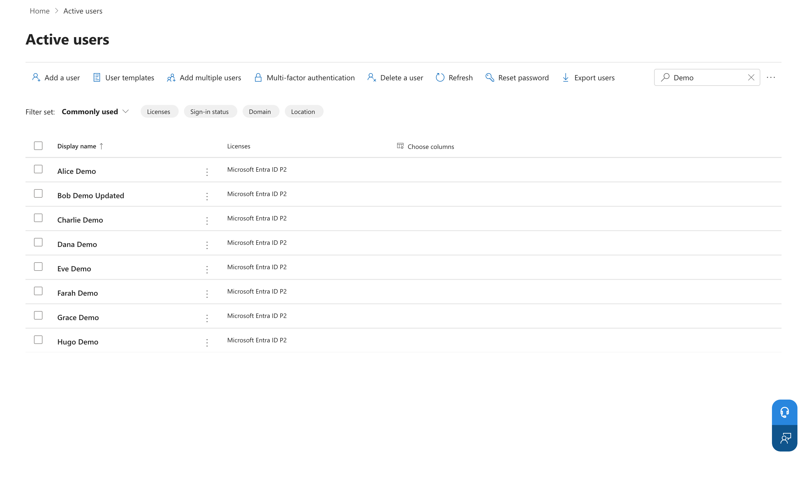
</a>

*The directory user list confirms Microsoft licensing, not AppFlowy access.*

| Workspace | Spaces to prepare |
| --- | --- |
| Demo Workspace | General, Demo Intelligence, Internal IT, HR, Product |
| HR Workspace | General, Shared |
| Executive Committee Workspace | General, Shared |

Create a test page in each space and confirm the setup owner can open all nine.
Configure [sign-in](AUTHENTICATION.md) separately: SCIM provisions accounts but
does not sign people in. Login emails must match the provisioned identities.
Use a separate Web session for each person.

This example uses a local self-hosted build and cloud-managed Entra groups. It
does not certify a published Docker release, Entra SSO, AD import or nested groups.
For on-premises AD, first configure an [AD-to-SCIM route](AD_SCIM_AUTO_SYNC.md).

## 2. Connect Entra

In AppFlowy Admin, open **Authentication → SCIM Provisioning**. Create one
connection per workspace, defaulting to **Member**. On the Demo connection only,
map **Admin → Owner**.

<a href="assets/scim-demo-expanded/09-admin-owner-role-mapping.png">
  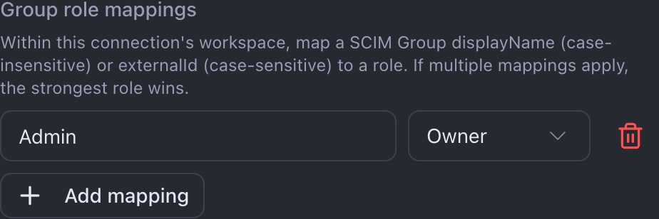
</a>

*This mapping grants Demo workspace administration, not instance administration.*

In Entra, create the eight **Security** groups with **Assigned** membership.
Add each person to the group in the opening table. Leave Microsoft administrative
role assignment off.

<a href="assets/scim-demo-expanded/01-entra-eight-groups.png">
  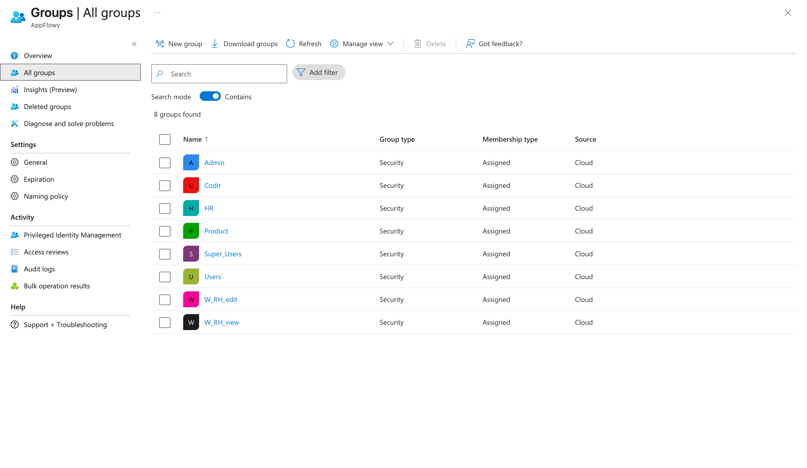
</a>

Create one enterprise application per connection. Copy its matching SCIM endpoint
and bearer token privately, test the connection, then use **Sync only assigned
users and groups**. Entra requires a reachable HTTPS endpoint.

| Application | Assigned groups |
| --- | --- |
| Demo Workspace | Admin, Users, Super_Users, Codir, HR, Product |
| HR Workspace | W_RH_view, W_RH_edit |
| Executive Committee Workspace | Codir |

Codir is assigned to two applications, so eight source groups produce nine
AppFlowy workspace groups. A person in any assigned Demo group already receives
Demo membership; they do not also need Users.

See the three application assignments

<a href="assets/scim-demo-expanded/03-entra-demo-workspace-assignments.png">
  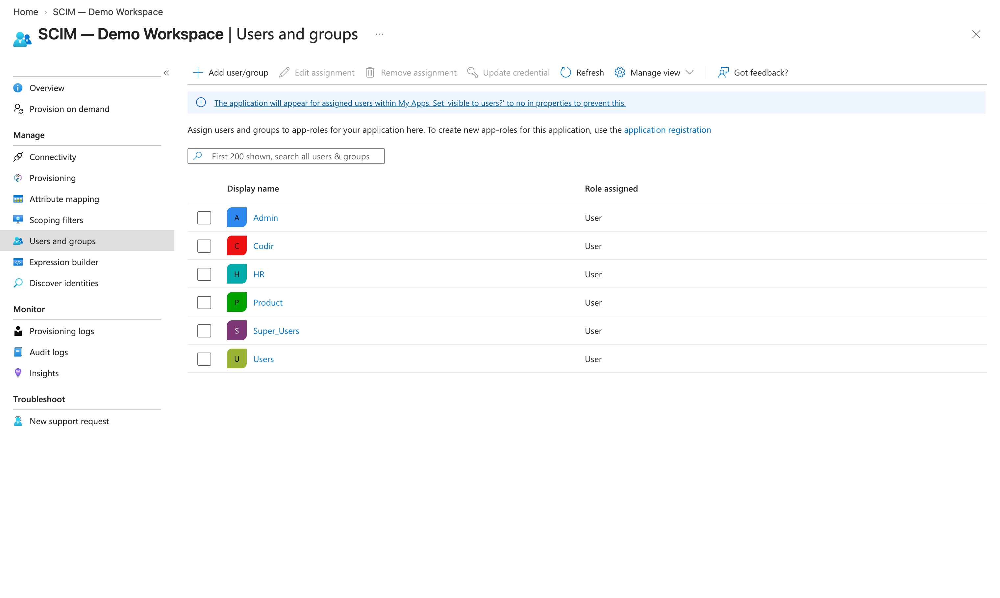
</a>

*Demo receives six groups.*

<a href="assets/scim-demo-expanded/04-entra-hr-workspace-assignments.png">
  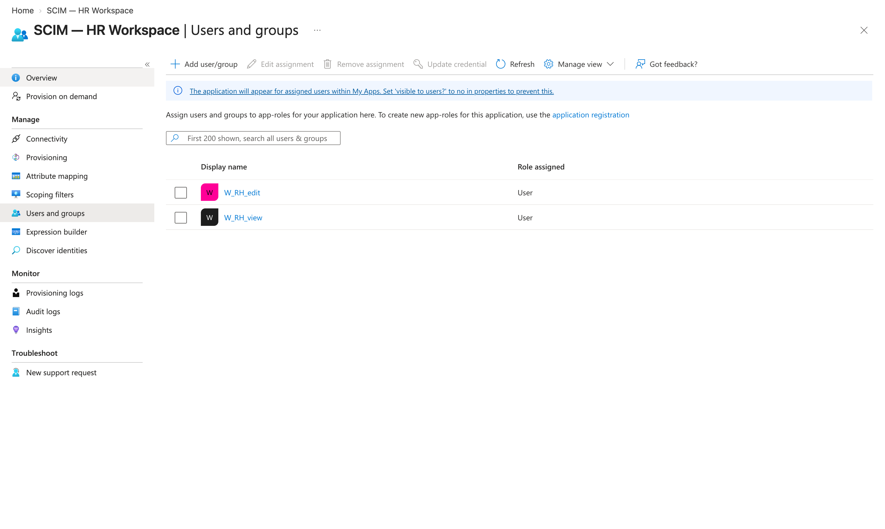
</a>

*HR receives its viewer and editor groups.*

<a href="assets/scim-demo-expanded/05-entra-executive-workspace-assignments.png">
  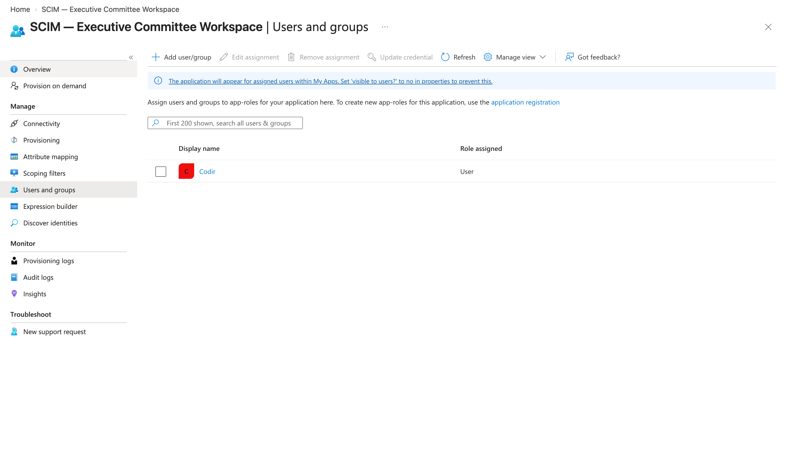
</a>

*Executive receives Codir.*

Follow the [Entra attribute-mapping steps](ENTRA_SCIM_AUTO_SYNC.md), including
group names and members. Enable the required Create, Update and Delete actions,
then start provisioning.

## 3. Check synchronization

Open each connection's **SCIM groups** monitor in AppFlowy Admin. The baseline
has **six Demo groups, two HR groups and one Executive group**, each with one
eligible member. Compare the actual member with the opening table.

Demo’s expanded baseline arrived through normal provisioning. The HR and
Executive baselines were delivered with **Provision on demand**.

<a href="assets/scim-demo-expanded/06-admin-demo-six-groups-synced.png">
  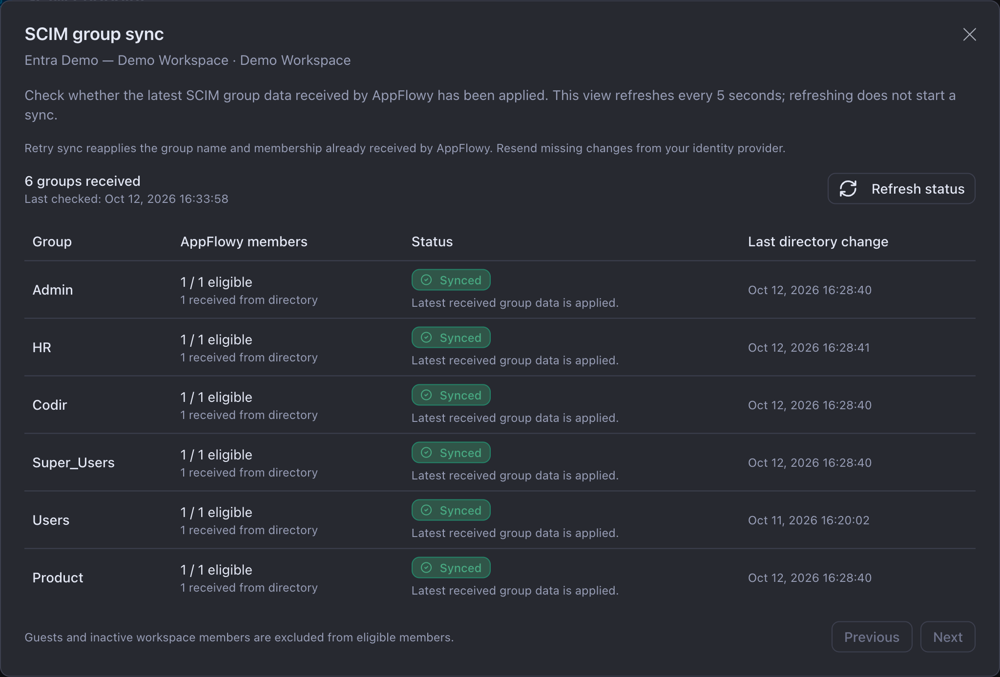
</a>

**Synced** means AppFlowy applied the data received so far. A newer Entra change
can still be waiting for delivery. **Refresh status** reads AppFlowy's state;
**Retry sync** reapplies received data. Neither asks Entra to send pending changes.
See [SCIM operations](SCIM_OPERATIONS.md) for errors and seat recovery.

See the HR and Executive sync monitors

<a href="assets/scim-demo-expanded/07-admin-hr-two-groups-synced.png">
  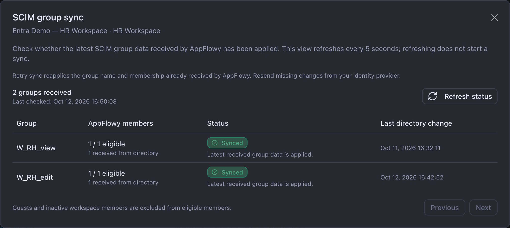
</a>

*HR has one viewer and one editor, in separate groups.*

<a href="assets/scim-demo-expanded/08-admin-executive-group-synced.png">
  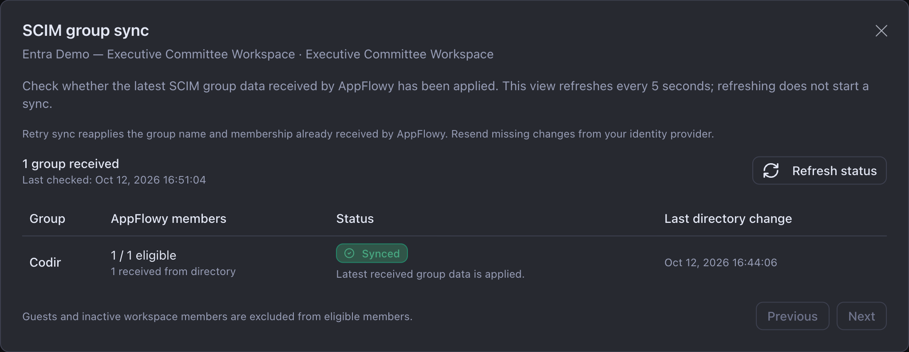
</a>

*Codir is also received by Executive, with Eve as its member.*

## 4. Set space access

In each test space, open **Manage Space → General**, select **Custom**, then set
**Space members → Can edit** and **Everyone else → Can view**. In **Members**, add
these editor groups as ordinary Space members:

| Workspace | Space | Editor groups |
| --- | --- | --- |
| Demo Workspace | General and Demo Intelligence | Admin, Super_Users |
| Demo Workspace | Internal IT | Admin |
| Demo Workspace | HR | Admin, HR |
| Demo Workspace | Product | Admin, Product |
| HR Workspace | General and Shared | W_RH_edit |
| Executive Committee Workspace | General and Shared | Codir |

Do not add viewer groups as Space members: that would give them Edit. Other
members of the same workspace already receive View. People outside that
workspace receive nothing from Everyone else.

For existing spaces, review owners, direct members and page shares first.
Public-to-Custom conversion can leave explicit members. Remove unintended demo
grants; ownership or another grant can otherwise preserve access.

See the Custom policy and editor-group assignment

<a href="assets/scim-demo-expanded/19-web-custom-space-permissions.png">
  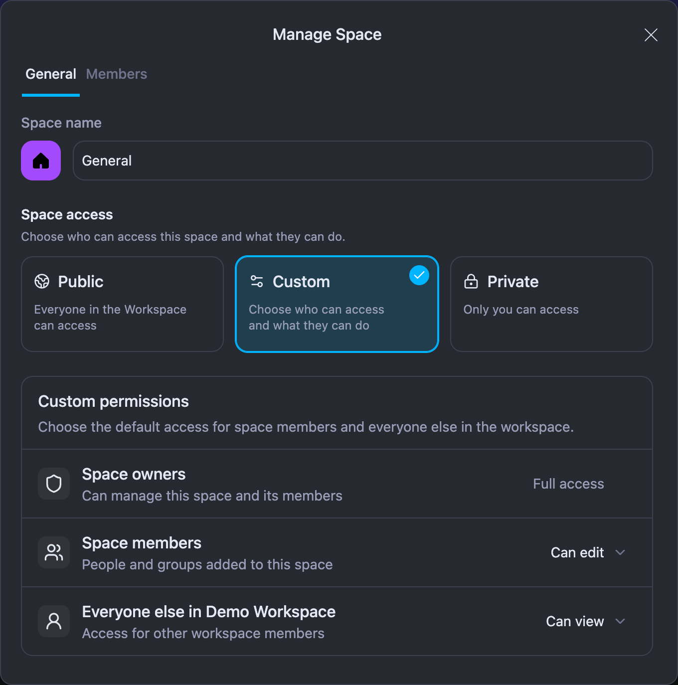
</a>

*This policy gives ordinary Space members Edit and other admitted workspace members View.*

<a href="assets/scim-demo-expanded/20-web-super-users-space-grant.png">
  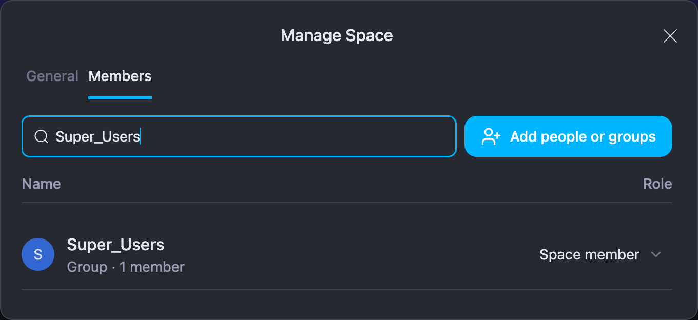
</a>

*Super_Users receives Edit through the space’s member policy.*

## 5. Verify access

Test a document in every space as each person: **72 cases — 13 Edit, 23 View
and 36 No access**. Confirm the setup owner can open each target first.

| Expected access | What to check |
| --- | --- |
| Edit | Save a unique note, reload, and confirm it independently from the owner session |
| View | Try input and confirm saved content is unchanged |
| No access | Open the direct page URL and confirm denial without document content |

**All 72 Web checks passed:** 13 Edit, 23 View and 36 denied direct links.
Independent saved-content reads confirmed all 13 editor notes were saved and
none of the 23 attempted viewer notes were saved. API checks also confirmed
workspace roles, group membership and configured space grants.

Earlier test notes remain on these pages; use the person/group table for current access.

View access and denied direct links: Alice and Bob

<a href="assets/scim-demo-expanded/10-web-alice-general-view.png">
  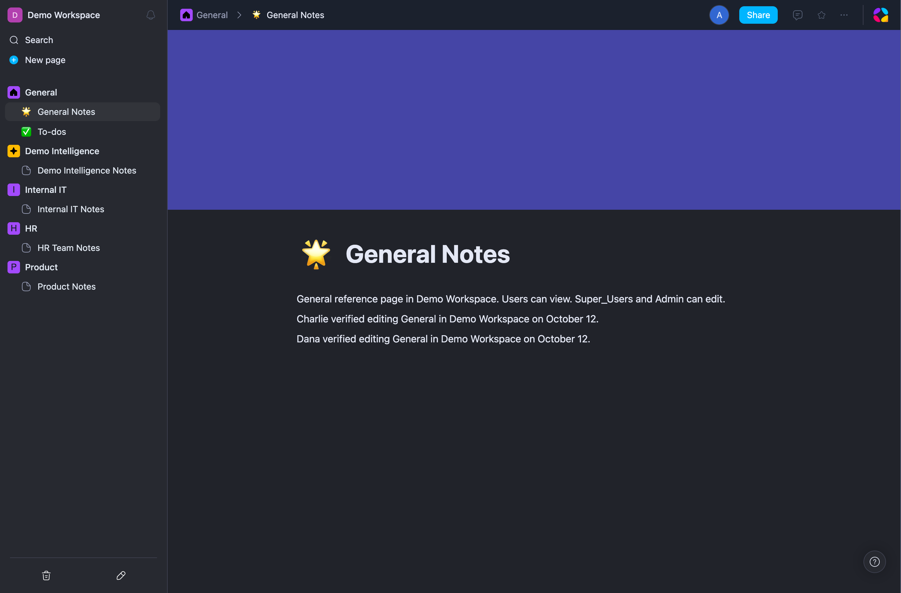
</a>

*Alice can read Demo pages but cannot save edits.*

<a href="assets/scim-demo-expanded/11-web-bob-hr-view.png">
  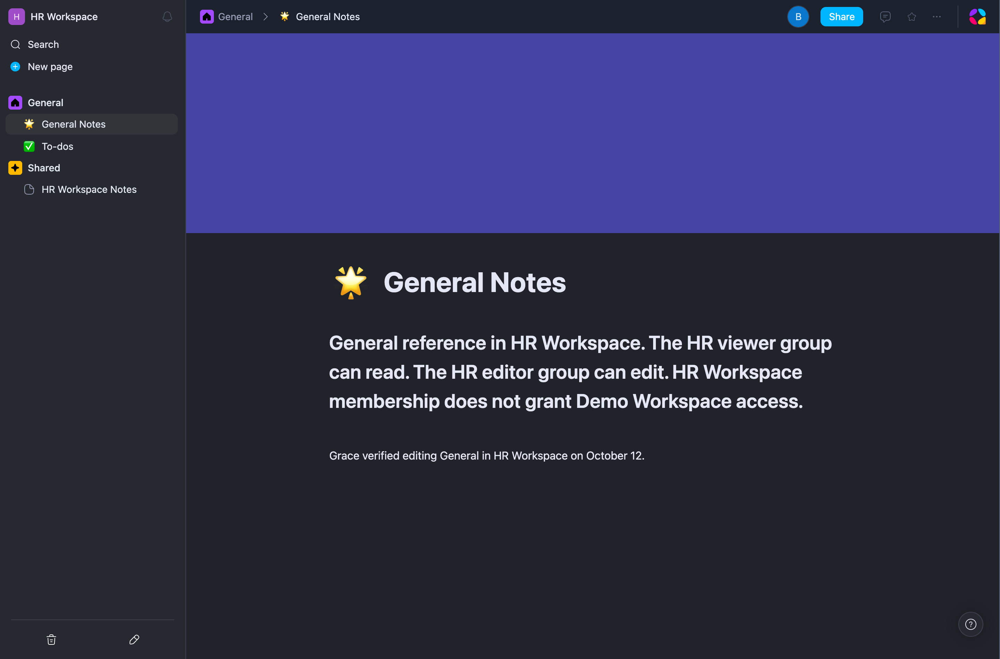
</a>

*Bob can read HR Workspace pages.*

<a href="assets/scim-demo-expanded/12-web-bob-demo-denied.png">
  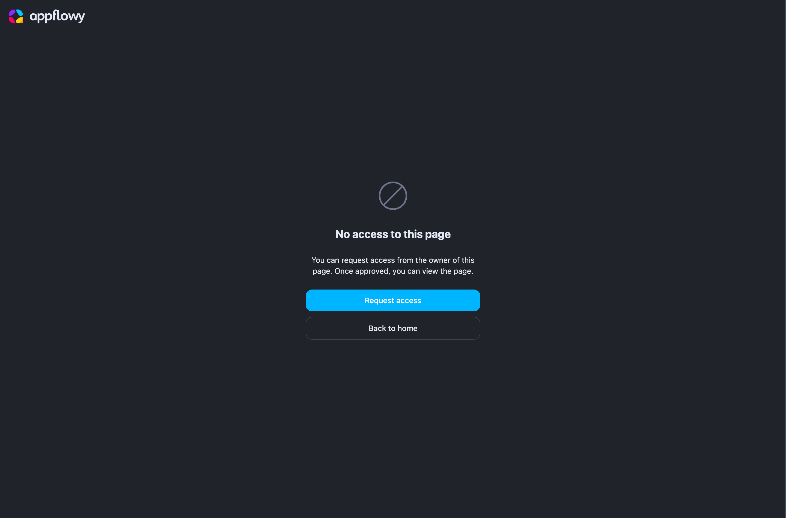
</a>

*HR membership does not grant Demo access; a direct Demo page link is denied.*

Edit access: Charlie, Farah, Hugo, Grace, Eve and Dana

<a href="assets/scim-demo-expanded/13-web-charlie-editor.png">
  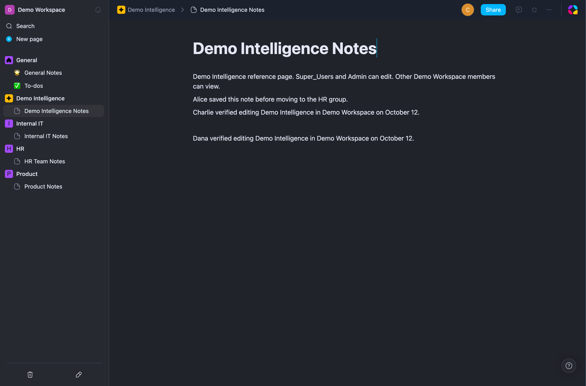
</a>

*Charlie — Super_Users: edits General and Demo Intelligence; views the other Demo spaces.*

<a href="assets/scim-demo-expanded/14-web-farah-hr-space-editor.png">
  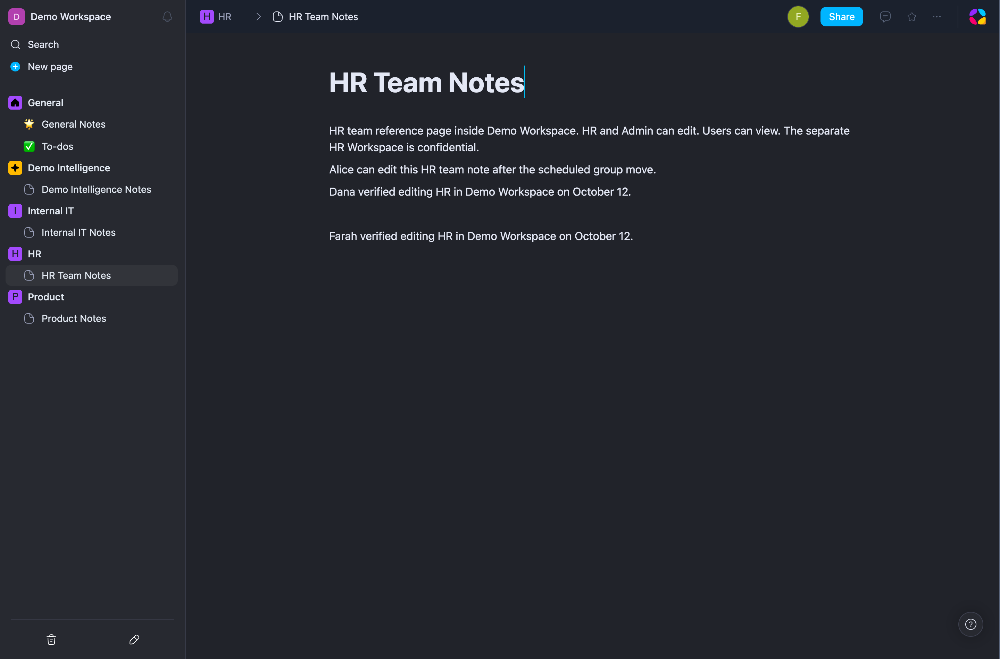
</a>

*Farah — HR: edits Demo’s HR space. This is separate from HR Workspace.*

<a href="assets/scim-demo-expanded/15-web-hugo-product-editor.png">
  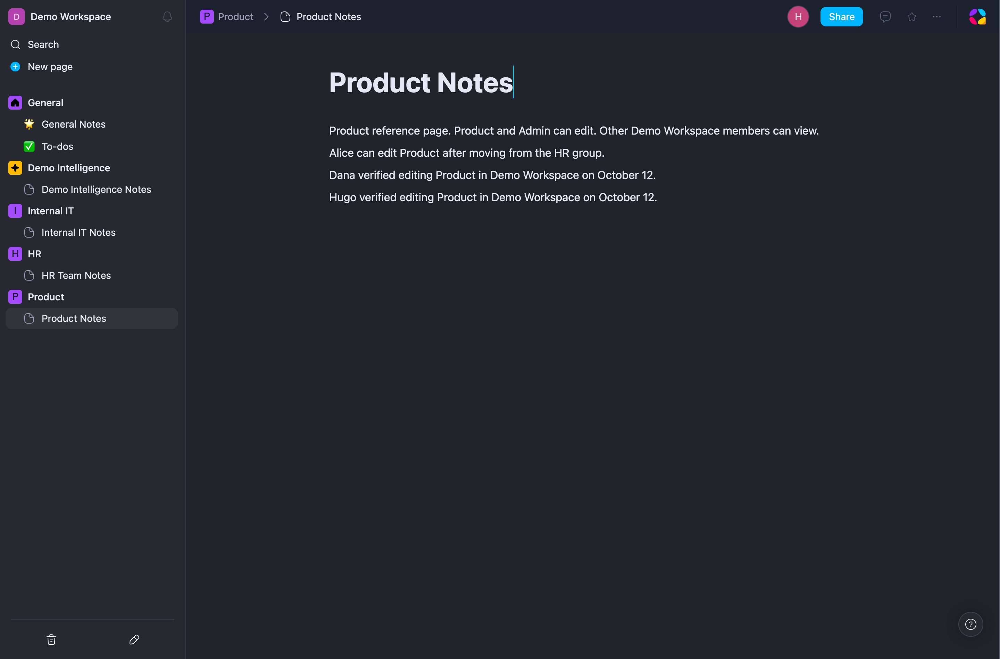
</a>

*Hugo — Product: edits Product and views the other Demo spaces.*

<a href="assets/scim-demo-expanded/16-web-grace-hr-workspace-editor.png">
  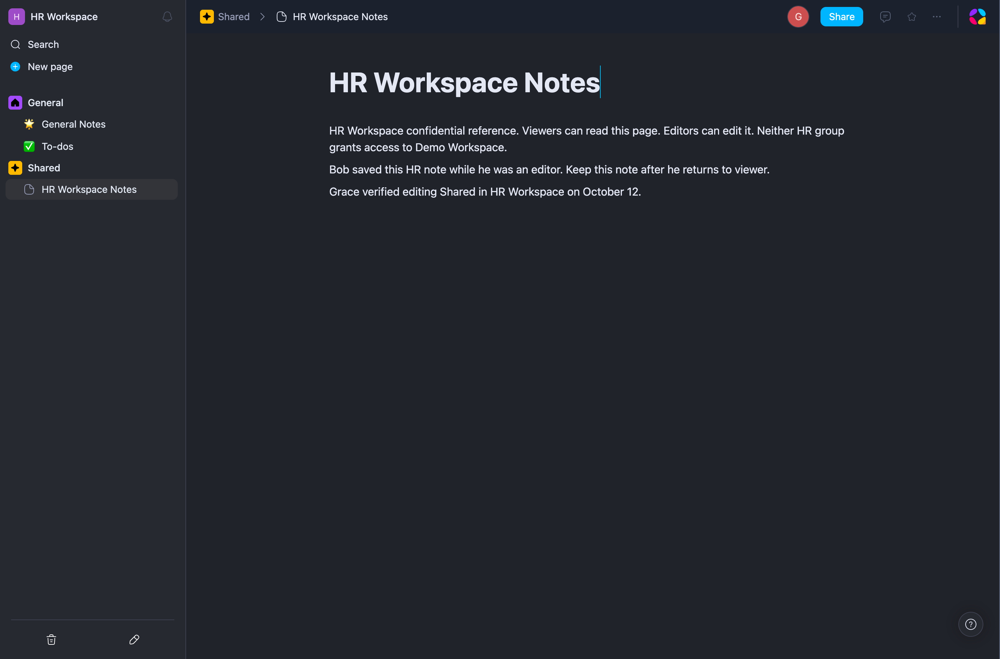
</a>

*Grace — W_RH_edit: edits both HR Workspace spaces, with no Demo membership.*

<a href="assets/scim-demo-expanded/17-web-eve-executive-editor.png">
  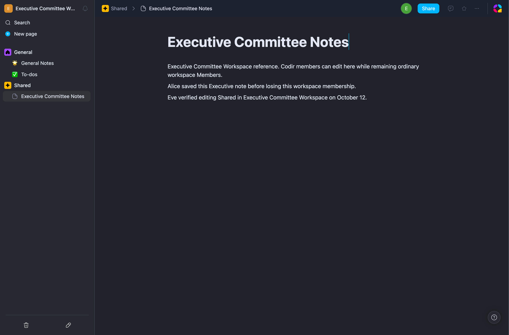
</a>

*Eve — Codir: edits Executive pages while remaining a Member; views Demo pages.*

<a href="assets/scim-demo-expanded/18-web-dana-admin-editor.png">
  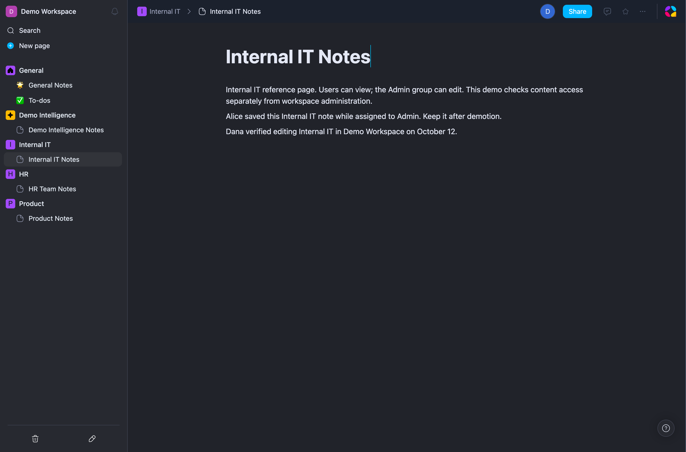
</a>

*Dana — Admin: edits all five configured Demo spaces. Workspace administration is a separate check.*

Check administration separately: Dana can administer Demo, ordinary Members
cannot, and none of these people has instance administration. Document editing
does not prove database or creation permissions.

## 6. Move Charlie to another group

Charlie starts in **Super_Users**. Move him to **HR** without deleting his account:

1. In Entra, add Charlie to **HR** and deliver that addition.
2. Confirm his new membership is applied, then remove him from **Super_Users**.
3. Deliver the removal and check AppFlowy's group monitor.
4. Open the same pages as Charlie and compare access below.

For this run, both changes were delivered with **Entra → Provision on demand**.
The result demonstrates the access change after SCIM delivery; it is not a new
scheduled-cycle timing test.

See the source group changes

<a href="assets/scim-demo-expanded/21-entra-charlie-added-to-hr.png">
  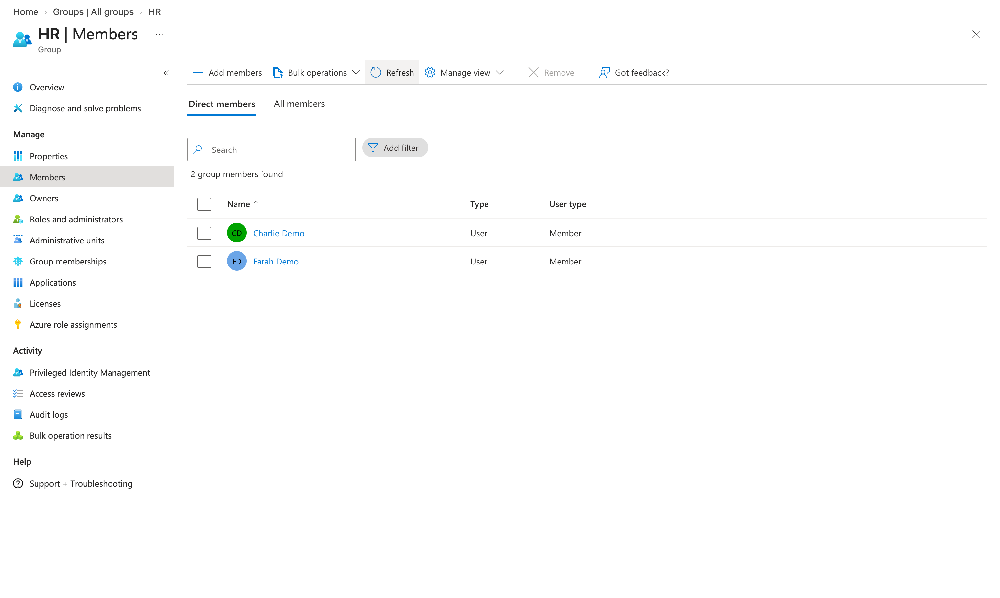
</a>

*Add Charlie to HR before removing his old assignment.*

<a href="assets/scim-demo-expanded/22-entra-charlie-removed-from-super-users.png">
  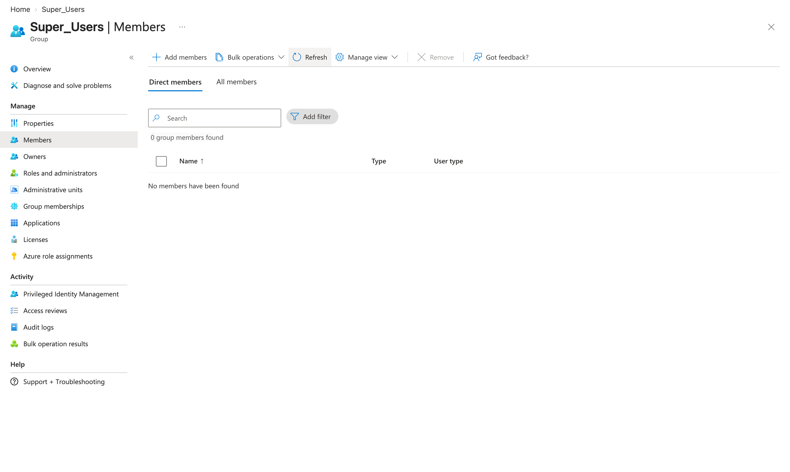
</a>

*The source removal leaves Charlie in HR, still assigned to the Demo application.*

<a href="assets/scim-demo-expanded/23-admin-charlie-move-synced.png">
  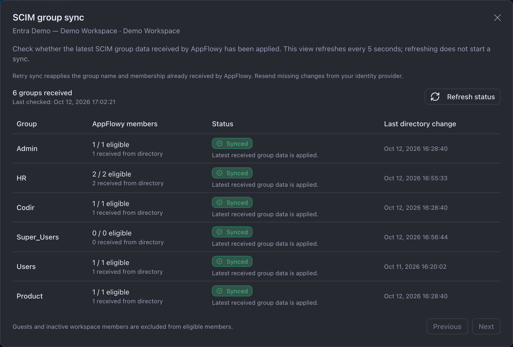
</a>

*The received groups match the move: HR has Charlie and Farah; Super_Users is empty.*

| Charlie's access | Before: Super_Users | After: HR |
| --- | --- | --- |
| General and Demo Intelligence | Edit | View |
| HR space inside Demo Workspace | View | Edit |
| Internal IT and Product | View | View |
| HR Workspace and Executive Committee Workspace | No access | No access |

All nine fresh-session checks passed after the move. Charlie kept the same
account and workspace membership. His previous notes remained, and his new HR
edit was saved. No user was deleted or recreated.

See Charlie's access after the move

<a href="assets/scim-demo-expanded/24-web-charlie-after-move-view.png">
  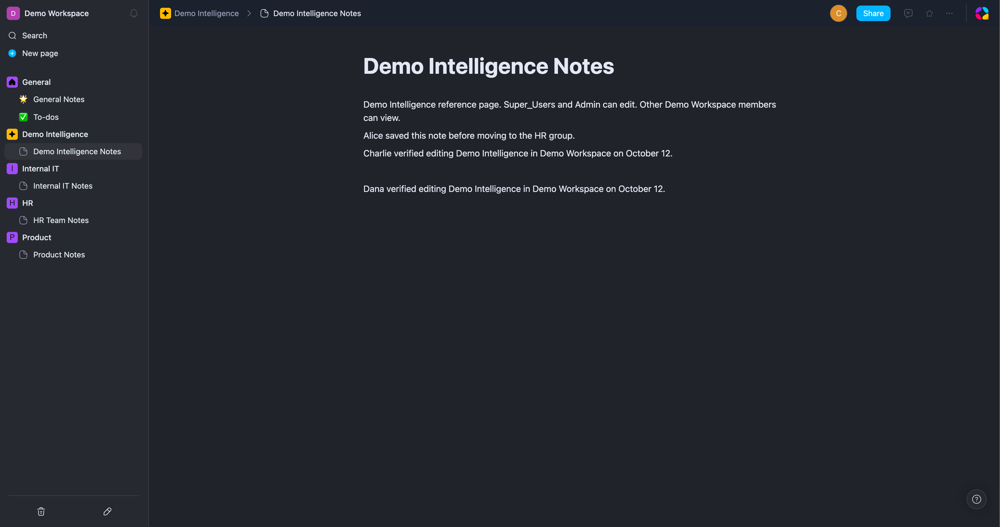
</a>

*His earlier note remains. Fresh-session input and saved-content checks confirmed View access.*

<a href="assets/scim-demo-expanded/25-web-charlie-after-move-hr-edit.png">
  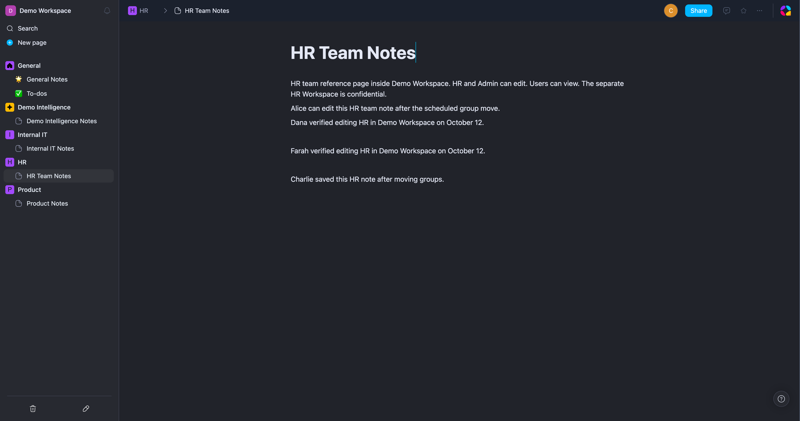
</a>

*Charlie can now edit the HR space inside Demo Workspace.*

**Client limitation:** an already-open editor still allowed local typing after
access was reduced, and that text could remain after reloading the tab. Independent
server reads confirmed the forbidden text was not saved. A fresh isolated session
showed the correct read-only content. Reloading an old tab alone is therefore
not enough to verify that access has refreshed.

To restore the example, add Charlie back to Super_Users and verify delivery
before removing HR. We completed this restoration: Charlie's nine access checks
passed again, all nine workspace groups returned to one member each, and seat
usage stayed at 9/10. His HR note remained after he lost HR editing access.

See the restored baseline

*HR returns to Farah only; Super_Users returns to Charlie only. The other groups are unchanged.*

The [October 11 record](assets/scim-demo/CAPTURE_NOTES.md) separately covers a
scheduled group move, HR viewer/editor changes, workspace offboarding, Owner
role demotion, and group creation, renaming and deletion using Alice and Bob.
Those are earlier results, not additional tests with these eight personas.

## Current limitations

| Requirement | Current limitation |
| --- | --- |
| Different groups get View/Edit while everyone else is denied | Ordinary Space members share one level; this recipe lets other admitted workspace members View |
| Edit pages but forbid space creation, or let only selected groups create spaces | The inspected clients cannot enforce the requested per-person/group creation rules |
| Only selected people create workspaces | Requires implementation |
| Automatic access to all future spaces | Explicit grants do not provide a future-space policy |
| Owner can open every Private space | Workspace Owner has no blanket Private-space bypass |
| No access overrides another group's grant | This example uses absence of a grant, not an overriding deny |
| Immediately refresh a previously open editor after revocation | Old local state can remain editable; the fresh-session and saved-content checks above are required |

Promotion to workspace Owner does not automatically add ownership of existing
Custom spaces. Demotion does not remove separately assigned space ownership.
License activation here is not proof of automatic recovery from an earlier seat
failure. See the [capture notes](assets/scim-demo-expanded/CAPTURE_NOTES.md) for
build provenance and the exact evidence collected.

## Finish the demo

1. Restore the opening group memberships and verify identities, notes and access.
2. Pause provisioning, disable the demo connections and close temporary public ingress.
3. Keep the workspaces and notes for inspection.
4. Cancel the Microsoft trial when finished and verify renewal is disabled.
