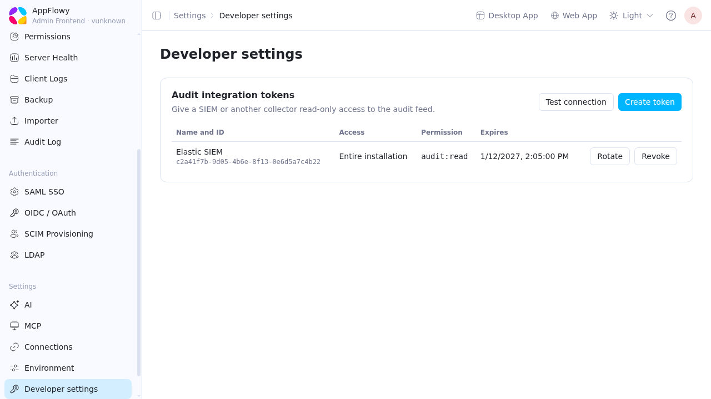
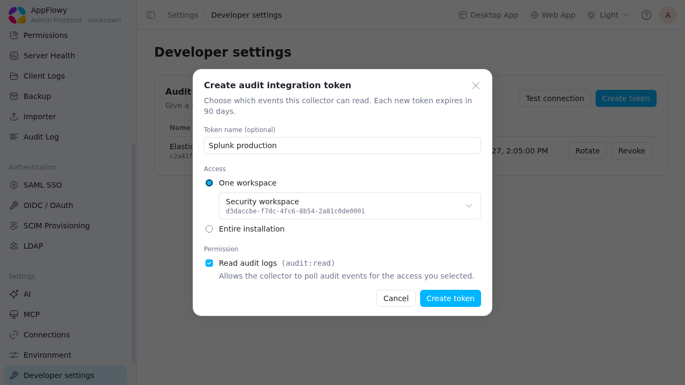
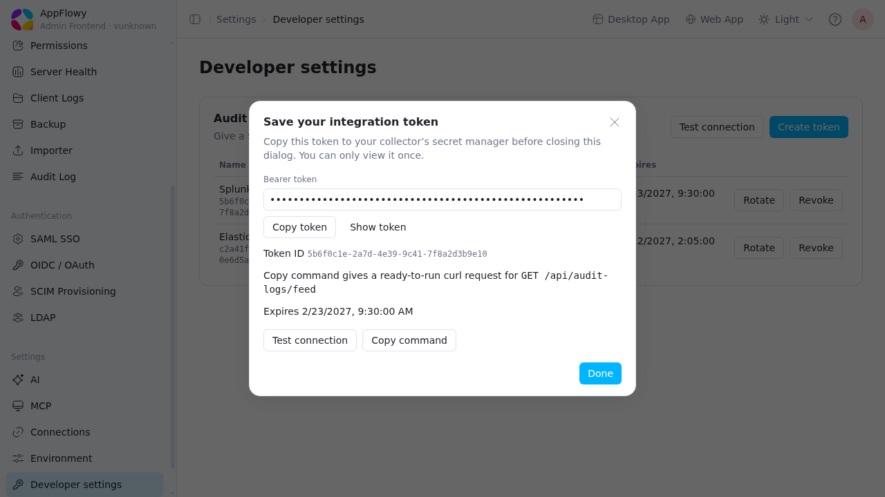
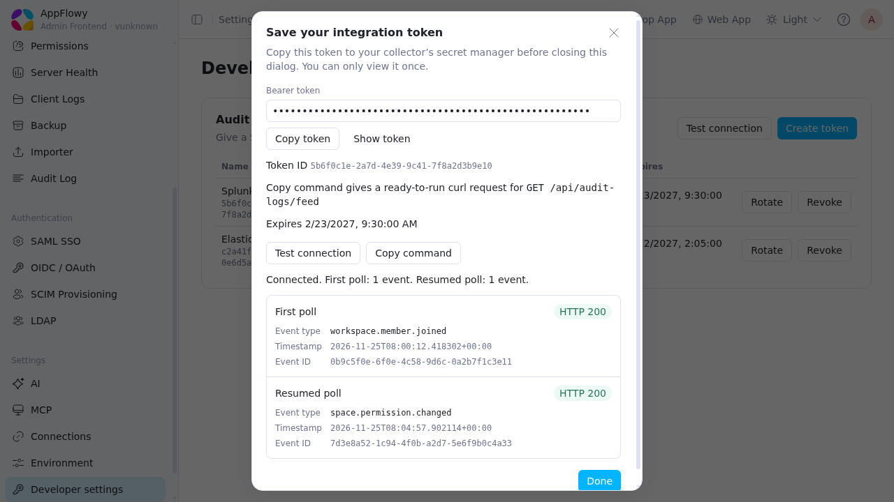
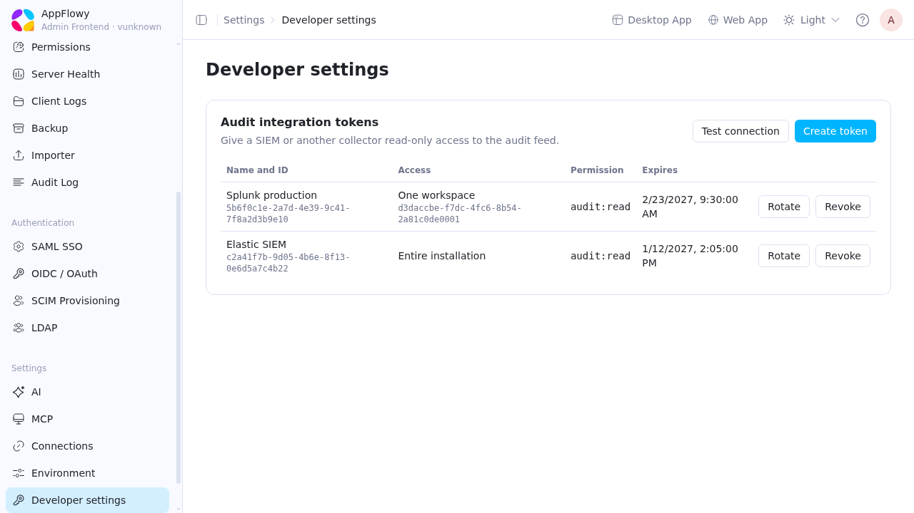

# Send audit logs to a SIEM

[Documentation](README.md)

AppFlowy Self-Hosted can hand its audit events to a SIEM or log collector, such as Splunk, Elastic, Microsoft Sentinel, or a script of your own. You create a read-only token in the Admin console, and the collector asks one HTTPS address for new events. Every answer includes a checkpoint, so a collector that stops and starts again continues where it left off.

To search or export events by hand, use the [Audit Log page](AUDIT.md) instead.

## Before you begin

Make sure you have:

- A self-hosted **Team** or **Enterprise** license.
- [Audit logging enabled](AUDIT.md#step-1-enable-audit-logging). The feed carries the events AppFlowy records while auditing is on. See [what is recorded](AUDIT.md#what-is-recorded).
- `admin-frontend` and `appflowy-cloud` releases that include **Developer settings**.
- A system administrator sign-in to the Admin console at `https://your-domain/console`.
- An HTTPS address for your server. The collector sends a secret token with every request.

## 1. Create a token

Open **Settings → Developer settings** and select **Create token**.



1. Enter a **Token name** that tells you which collector uses it, for example `Splunk production`.
2. Under **Access**, choose what the collector may read:
   - **One workspace**: only that workspace's events. Search for the workspace by name, owner email, or ID.
   - **Entire installation**: every workspace, plus events that belong to no workspace, such as sign-ins.
3. Under **Permission**, select **Read audit logs** (`audit:read`).
4. Select **Create token**.



Create one token for each collector. You can then replace or remove one without touching the others.

## 2. Save the token

The token is shown once. Select **Copy token** and store it in your collector's secret store before you close the dialog. Admin cannot show it again.



A token works for 90 days. [Rotate it](#rotate-or-revoke-a-token) before then.

## 3. Test the connection

You can check the token before you configure anything else, in two ways.

**Test connection** sends two requests from your browser with the token. The first asks for one event. The second continues from the checkpoint the first one returned. For each request you see the HTTP status and the type, time, and ID of the event that came back, or **No events returned.** when there is nothing new.



**Copy command** copies a ready-to-run `curl` command that contains your server address and the token. Paste it into a terminal on the machine where the collector will run. This also proves that machine can reach the server:

```bash
curl -sS 'https://your-domain/api/audit-logs/feed?limit=1' -H 'Authorization: Bearer <token>'
```

A working token answers with JSON like the [example below](#what-the-server-returns). The command is written for macOS, Linux, WSL, and Git Bash shells. It contains the secret, so do not paste it into chat tools or tickets.

To test a saved token later, select **Test connection** at the top of Developer settings and paste the token.

## 4. Point your collector at the feed

Configure the collector to send this request:

| Setting | Value |
| --- | --- |
| Method and address | `GET https://your-domain/api/audit-logs/feed` |
| Header | `Authorization: Bearer <token>` |
| `limit` (optional) | Events per answer, 1 to 500. The default is 100. |
| `cursor` (optional) | The `next_cursor` from the previous answer. Leave it out on the very first request. |

The token decides which workspace the collector reads. The request has no workspace setting.

Then repeat these steps:

1. Send the request. The first one, without `cursor`, starts at the oldest event the server still keeps.
2. Store the events. If an event `id` arrives twice, keep one copy.
3. After the events are safely stored, save `next_cursor`. Save it even when `events` is empty.
4. If `has_more` is `true`, send the next request straight away. Otherwise wait, for example one minute.

If a request fails or the collector restarts, send the last saved `next_cursor` again. No event is skipped; a few may arrive twice, which step 2 handles.

```bash
# First request
curl --fail-with-body --get "https://your-domain/api/audit-logs/feed" \
  --header "Authorization: Bearer $SIEM_TOKEN" \
  --data-urlencode "limit=100"

# Every later request
curl --fail-with-body --get "https://your-domain/api/audit-logs/feed" \
  --header "Authorization: Bearer $SIEM_TOKEN" \
  --data-urlencode "limit=100" \
  --data-urlencode "cursor=$SAVED_CURSOR"
```

### What the server returns

```json
{
  "events": [
    {
      "id": "0b9c5f0e-6f0e-4c58-9d6c-0a2b7f1c3e11",
      "event_timestamp": "2026-11-19T08:00:00.123456+00:00",
      "event_type": "workspace.member.joined",
      "event_status": "success",
      "workspace_id": "d3daccbe-f7dc-4fc6-8b54-2a81c0de0001",
      "actor_id": "a6d804e5-00d5-4d99-961c-13b9f4c00002",
      "actor_type": "user"
    }
  ],
  "next_cursor": "eyJ0b2tlbl9pZCI6…",
  "has_more": false
}
```

The example shows only some fields. Each event also carries the actor, target, request details, and before and after values when the event recorded them. Treat `next_cursor` as an opaque value: store it and send it back unchanged.

## Response codes

Error answers are JSON with one `error` field, for example `{"error":"cursor_expired"}`.

| Status | `error` | What it means | What to do |
| --- | --- | --- | --- |
| 200 | – | Success, including an empty `events` list | Store the events and save `next_cursor`. |
| 400 | `invalid_query`, `invalid_cursor` | A setting is not valid, or the cursor was changed or belongs to another token | Fix the request. If the cursor is refused, start again without one and drop repeated `id`s. |
| 401 | `invalid_token` | The token is wrong, expired, or revoked, or its workspace was deleted | Check the token, then rotate it or create a new one. |
| 403 | `insufficient_scope`, `license_required` | The token lacks `audit:read`, or the license does not include this feature | Create a token with **Read audit logs**, or check the license. |
| 410 | `cursor_expired` | Events after your checkpoint were removed before the collector read them | Record a gap, start again without a cursor, and drop repeated `id`s. |
| 429 | `too_many_requests` | The server is already answering other collectors | Wait for the `Retry-After` time, then send the same request. |
| 503 | `audit_disabled` | Audit logging is turned off | [Enable audit logging](AUDIT.md#step-1-enable-audit-logging). |
| 503 | `publication_pending`, `feed_unavailable` | The server cannot answer right now | Wait for `Retry-After` if present, then send the same request. |

## Rotate or revoke a token

Developer settings lists every token with its name, ID, access, permission, and expiry.



- **Rotate** gives the token a new secret and a new 90-day lifetime. The old secret stops working at once. Put the new secret in the collector; it continues from its saved checkpoint. Rotating also brings an expired token back.
- **Revoke** removes the token. The collector loses access at once. You can revoke while audit logging is off or after a license change.

Creating and rotating need audit logging turned on and a Team or Enterprise license.

## Good to know

- **Retention.** The server keeps audit events for 30 days by default. A collector that stays offline for longer than that receives `410` and has a gap. To keep events longer, [change the retention setting](AUDIT.md#environment-configuration).
- **Restore.** After you restore the server from a backup, the old tokens no longer work. The same can happen after you move the database to another PostgreSQL server with dump and restore. Create new tokens. Collectors then read the kept history again, so drop repeated `id`s.
- **Order.** Events arrive in the order the server finished writing them, which is not always the order of their timestamps. A long-running database operation can delay new events for a short time.
- **Many collectors.** Each `appflowy_cloud` server answers four feed requests at a time. Extra requests receive `429`.

## Troubleshooting

| Problem | What to check |
| --- | --- |
| **Developer settings** is missing from the sidebar | It appears on self-hosted servers only. Upgrade `admin-frontend` and `appflowy-cloud`, and sign in as a system administrator. |
| **Create token** and **Rotate** are disabled | Audit logging is off. [Enable it](AUDIT.md#step-1-enable-audit-logging), then return to this page. |
| "Creating and rotating integration tokens requires a self-hosted Team or Enterprise license." | Check the commercial license. Existing tokens can still be revoked. |
| The test or the collector gets `401` | Copy the whole token again. Check the expiry date in the list, and that the token's workspace still exists. |
| The connection test says to configure an HTTPS server URL | The Admin console only sends tokens over HTTPS, except to `localhost`. Serve AppFlowy over HTTPS. |
| The collector gets `200` with no events | Nothing new was recorded for this token's access. Check that auditing is on and that the action is [one that is recorded](AUDIT.md#what-is-recorded). |
| The collector gets `410` | It was offline for longer than the retention period, or events were removed before it read them. Record the gap and start again without a cursor. |
