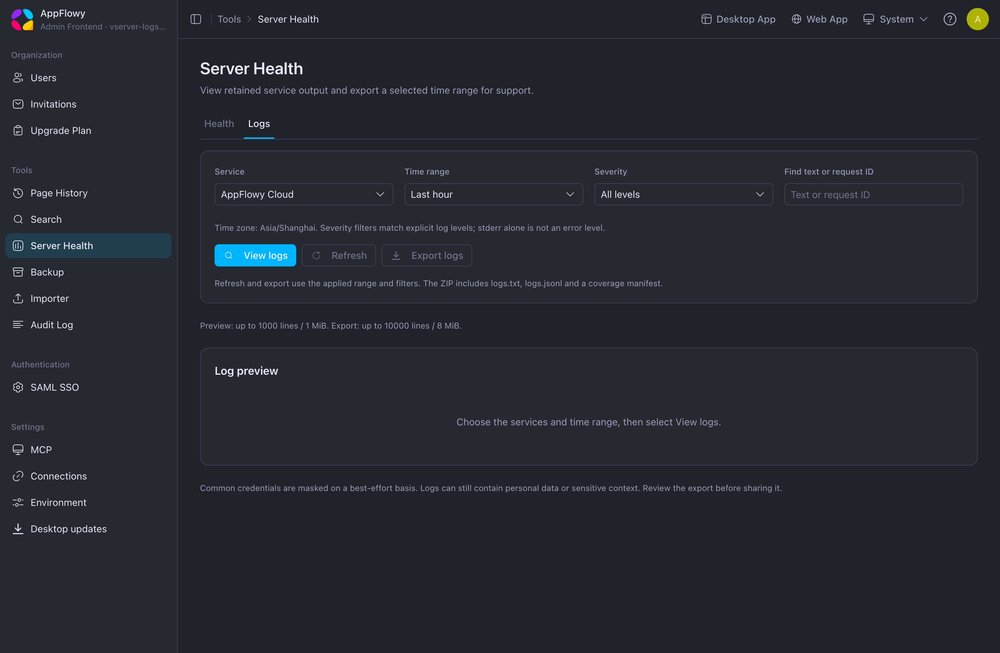
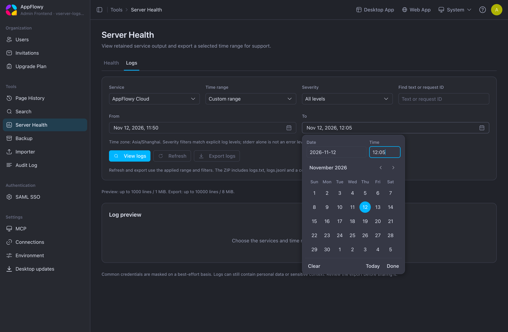
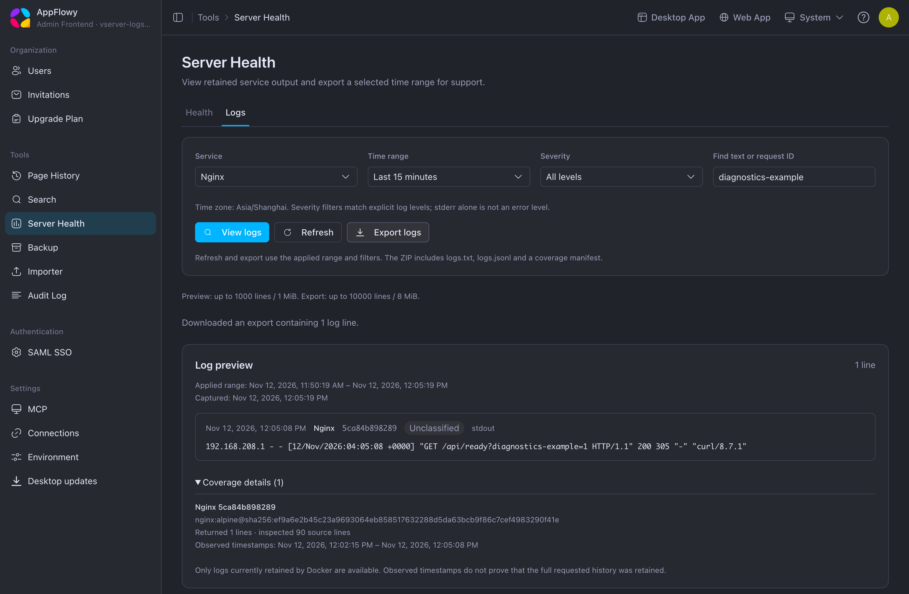

# Docker Compose

[Documentation](README.md)

For CPU, RAM, and storage guidance, see [Hardware requirements and sizing](HARDWARE_SIZING.md).
The [single-server profiles](HARDWARE_SIZING.md#single-server-sizing) provide example hardware sizes
for the default all-in-one Compose installation.

With Docker and Docker Compose **2.30 or newer** installed, first copy the environment template from the repository root:

```bash
cp deploy.env .env
```

Check the installed plugin with `docker compose version --short`. The configuration uses optional,
raw environment files for persistent restore selections, which require Compose 2.30 or newer.
Older plugins can reject the base file even while Backup is disabled. The CI tooling checks this
minimum before rendering any deployment.

Edit `.env` to set your domain, HTTPS/WebSocket schemes, credentials, and optional email or AI settings. Replace the example passwords and JWT secret before exposing the deployment publicly. Compose [loads the root `.env` automatically](https://docs.docker.com/compose/how-tos/environment-variables/variable-interpolation/), and Git ignores this file.

Compose uses the public `appflowyinc/appflowy_cloud` and `appflowyinc/appflowy_worker` images. Both provide AMD64 and ARM64 builds, and Docker selects the image architecture for your host automatically.

Nginx configuration and certificates remain in [`docker/nginx`](../docker/nginx). For HTTPS, replace the bundled development certificate and key in `docker/nginx/ssl/` with your deployment's certificates.

Start the services from the repository root:

```bash
docker compose up -d
```

With the default localhost settings, open [AppFlowy Web](http://localhost) or the [Admin console](http://localhost/console). The template creates the admin account `admin@example.com` with password `password`.

If upgrading an installation previously started from `docker/`, move its existing `.env` to the repository root and retain its Compose project name. For the old default, add `COMPOSE_PROJECT_NAME=docker` to `.env`; if you used a custom project name, keep that value. This reuses the existing named data volumes and the default network. Containers whose definition changed are recreated in place: `nginx` and `appflowy_cloud` leave the old `cloud_proxy` network, and `minio`, `appflowy_cloud`, and `appflowy_worker` move to new image references. Unchanged service definitions are reused. The old `<project>_cloud_proxy` network is left behind and can be removed with `docker network rm` after the upgrade.

## Redis

The bundled Redis service uses Redis's default `maxmemory=0`: no configured memory cap.
AppFlowy permits background task publication in this mode, so indexing and other queue-backed
features do not require an extra Redis memory setting. Host or container memory limits still apply.

If you explicitly configure a positive `maxmemory`, AppFlowy applies its percentage-based memory
admission check (80% by default). Use `noeviction` to retain queue and collaboration keys, and
allow `INFO memory` so the publisher can observe the configured limit. An unavailable memory
sample or actual Redis write refusal still defers publication. Changes to the sampled limit or
usage can take up to five minutes to become visible.

The same behavior applies to external Redis. AppFlowy honors the server's configuration and does
not change it at runtime.

## Backup

Backup is optional. Use Docker Compose **2.30 or newer**, set this value in the root `.env`,
and start the deployment:

```dotenv
APPFLOWY_BACKUP_PROFILE=backup
```

```bash
docker compose up -d
```

Open **Tools → Backup** in the Admin console. Cloud discovers the ready service automatically;
there is no additional Admin setting or `APPFLOWY_BACKUP_ENABLED` flag.
See the [Backup guide](BACKUP.md) for creating backups, exports, schedules, and restores.

The environment template selects [docker-compose.backup.yml](../docker-compose.backup.yml)
automatically. Keep its derived `COMPOSE_PROFILES`, `COMPOSE_PATH_SEPARATOR`, and `COMPOSE_FILE`
settings from [deploy.env](../deploy.env). When upgrading an older `.env`, copy those three
settings from the template without replacing your existing credentials or project name.
Using `--profile backup` alone does not select the supporting file.

### What startup prepares

The supplied configuration reuses the installation's database, Redis, and object-storage
connections. Backup creates a separate private artifact bucket, prepares its persistent work
and restore directories, and discovers the current Compose project. Its short startup step
configures Docker socket access, then runs the supervisor, worker, and recovery coordinator as
the image's `postgres` user. If the host socket is writable only by root, a supervised internal
bridge provides access; the host socket's ownership and permissions are unchanged. There is no manual
Docker group ID, `runner.env`, pgBackRest configuration, or stanza initialization step for new
online backups. The live PostgreSQL image and archive settings are unchanged.

With Backup enabled, Search starts as UID/GID `999`, matching Backup's `postgres` user.
Before Search starts, its entrypoint migrates the shared cache's ownership while retaining
file permissions. This lets Backup capture private LMDB data and use its reader lockfile.

The Backup coordinator has Docker administration access so it can pause and restart application
services during restore. The default writer list covers Cloud, GoTrue, Worker, Search, and AI.
If you add MCP, connectors, or other services that write to this installation, include their
Compose service names in the Backup service's `APPFLOWY_BACKUP_COMPOSE_WRITERS` environment
setting through a Compose override before using restore.

Use the Backup image published with your Cloud release. The
[release-image workflow](RELEASE_IMAGES.md) proposes its exact version and digest when
Backup is published. Once pinned, that Compose image reference determines the version;
use an explicit Compose override for qualification builds. Its PostgreSQL tools must support
your database version and extensions;
the bundled deployment uses PostgreSQL 16 with pgvector.

Qualify Cloud, Worker, Search, GoTrue, Admin, and Backup together. A successfully pulled `latest`
tag does not establish compatibility. For an unreleased build, select its exact image through an
override and retain the image digest with the deployment's recovery records. The
[Backup CI lane](deployment-ci.md#backup-acceptance) records the tested digests and fails if the
running images differ.

### Storage and retention

By default, Backup reuses your S3/MinIO endpoint and credentials and creates a private bucket
named `<APPFLOWY_S3_BUCKET>-backups`. For example, `appflowy` uses `appflowy-backups`. The
application attachment bucket and the backup bucket must be different.

For the bundled MinIO deployment, the existing credentials can create the bucket automatically.
For external S3, allow bucket creation or pre-create a private bucket with the required read,
write, list, multipart-upload, and cleanup permissions. Readiness also needs `s3:ListBucket`
for its `HeadBucket` check, `s3:GetBucketAcl`, and `s3:GetBucketPolicy` so it can verify that
the bucket is private. Grant `s3:CreateBucket` only when startup should create a missing bucket.
An existing bucket must remain private; startup does not rewrite its access policy. Cloud uses
the same artifact settings for authenticated downloads.

No additional environment settings are needed for the standard deployment. To use a different
private bucket name, optionally set `APPFLOWY_BACKUP_BUCKET` in the existing root `.env`.
Portable exports expire after 24 hours by default. Recovery backups default to 30 days;
scheduled-backup retention can be selected in the Admin console.

For advanced deployments, custom artifact-storage settings must be passed to **both** Cloud and
Backup through a Compose override. Runner-only settings, such as retention or the writer list,
belong on the Backup service. Append your override file to `COMPOSE_FILE` in `.env` so every
later `docker compose up -d` includes it; the supplied explicit file list does not automatically
load `docker-compose.override.yml`. See the service's
[environment reference](https://github.com/AppFlowy-IO/AppFlowy-Cloud-Premium/blob/main/services/appflowy-backup/deploy/runner.env.example)
for the supported advanced settings. Keep credentials private.

Recovery backups, portable exports, and restore staging consume disk and object storage. Keep
adequate free space and retain the private artifact bucket and Docker data volumes. Search-index
and embedding data are excluded from new backups by default; administrators can include them in
the creation dialog. Page and database content are captured independently of those options.

### Persistent restore state

Backup generates private deployment state in its `backup_work` volume and selected resource
files under `backup-ops/runtime/`. Compose reads these files automatically on later starts so
a normal `docker compose up -d` continues using the restored object bucket, Redis database, and
search directory. The directory is created automatically and ignored by Git. Preserve it when
moving or upgrading the deployment; do not edit its generated files by hand.

Keep the original Compose files, `.env`, and appended overrides as the deployment inputs.
A flattened `docker compose config` export resolves the current environment files and can freeze
old storage selections; do not replace the installed source files with that export after restore.
The selected object bucket and Redis database must agree across Cloud, Worker, Search, and any
additional writers. Search uses a fresh active index directory and rebuilds restored workspaces;
an included LMDB archive remains a diagnostic cache rather than being served as current data.

Keep the existing Compose project name when upgrading. If an older deployment used
`snapshot_runner`, stop and remove that old service with its previous configuration before
starting `appflowy_backup`. Preserve any older pgBackRest repositories and configuration needed
to restore legacy recovery chains; new backups no longer require them.

### Upgrade with existing backups

For the v0.19.2 storage rollout, follow the [release migration requirements](../README.md#release-notes):

1. Retain a usable recovery point, the deployment configuration and secrets, the private artifact
   bucket, `backup_work`, and `backup-ops/runtime/`. Keep the current Compose project name.
2. Drain application traffic and stop all application writers, including optional MCP or custom
   integrations. Pause Backup work for the rollout so capture cannot overlap the migration.
3. Run the updated Cloud migration runner, or the matching `appflowy-migrate` for a custom job.
   Preserve the existing migration history and checksums; do not edit migration records to bypass
   a restore or startup failure.
4. After migrations finish, start the matching GoTrue, Cloud, Worker, Search, Admin, and Backup
   builds, check readiness, and then resume application traffic.
5. Verify an existing recovery point or ZIP against the upgraded build in an isolated installation
   before relying on it for rollback. A rollback build must understand the updated storage protocol
   and migration history. Redacted exports also require Backup's schema policy to match the migrated
   Cloud schema.

Restore preparation uses the migration runner before switching the live database. During the
verification stage, Cloud's `/api/ready` probe can succeed while application requests remain fenced;
the supplied backup override uses this probe so the coordinator can finish the switch before
restarting other writers. Wait for the restore job and normal application readiness before opening
clients. Preserve the private restore journal if a coordinator restart interrupts this process.

### Pause Backup

```bash
docker compose stop appflowy_backup
```

Keep the enabled profile and storage settings while pausing the service. The application remains
available; new Backup operations are unavailable until its service is ready again. Existing
history and completed downloads remain visible. Clearing `APPFLOWY_BACKUP_PROFILE` alone does
not stop an already running container.

## Server logs

**Tools → Server Health → Logs** in Admin can preview retained Docker output and download a
support archive for Cloud, Worker, Search, AI, GoTrue and Nginx. It requires Cloud and Admin
releases that include this feature and the saved access setting, plus a compatible
`appflowyinc/appflowy_log_collector` image. The optional collector is disabled by default and must
be installed through the deployment steps below. Installations without a configured Docker collector
show that server-log viewing and export are unsupported; an unreachable configured collector is
reported separately.

This reader targets the self-hosted Docker Compose deployment supplied by this repository. It reads
retained container output, not native process logs. The standard `just restart-server` hosted build
does not support it; a separately built self-host-enabled Cloud can contact a configured Docker
collector even if Cloud itself runs outside Docker. The supplied Swarm/Helm files do not install or
configure this optional Compose collector. Healthy services do not imply that the collector is on.
A Cloud build without self-host support does not contain this feature: its
`/api/admin/server-logs` paths return HTTP **404**, Admin shows no Logs tab for it, and changing
environment values cannot enable collection.

Before enabling it, upgrade this deployment's `docker-compose.yml` and `deploy.env` to versions
that include `appflowy_log_collector`, together with compatible Cloud and Admin images. Adding
settings to an older `.env` alone cannot install the missing service. Preserve the existing `.env`,
Compose project name and storage volumes when updating deployment files.

Upgrade every Cloud replica to a release that includes the access setting before relying on
**Allow log access** being off. An older replica does not enforce this saved setting.

### Enable the collector

Set one value in the existing root `.env`:

```dotenv
APPFLOWY_SERVER_LOGS_PROFILE=server-logs
```

When upgrading `.env`, also copy the updated derived `COMPOSE_PROFILES` expression from
[`deploy.env`](../deploy.env). It preserves both the Backup and Server Logs profiles; keep the
existing `COMPOSE_FILE`, project name and credentials. Then validate and apply the configuration:

```bash
docker compose config --quiet
docker compose up -d
```

Then turn on **Allow log access** in Admin, as described below. Nothing else has to be set:

- **Credential.** Cloud and the collector authenticate with a credential that both derive from
  `GOTRUE_JWT_SECRET`, so there is no token to generate. The secret itself is never sent to the
  collector over the network. The credential is only as strong as that secret: replace the
  template value of `GOTRUE_JWT_SECRET`, as every deployment must.
- **Image.** `docker-compose.yml` names the collector image, and each release pins it together
  with the Cloud image it was published with.

This needs Cloud and collector releases that include the derived credential. Until a release
publishes the collector image, `docker-compose.yml` names
`appflowyinc/appflowy_log_collector:latest`, which is not published, so enabling the profile
fails to pull. Wait for deployment files that pin a released collector, or build and test the
matching sources and set `APPFLOWY_SERVER_LOGS_IMAGE`.

Three optional settings exist for installations that need them:

- `APPFLOWY_SERVER_LOGS_TOKEN` replaces the derived credential with your own. GoTrue, Worker and
  Search also hold the JWT secret and could compute the derived credential; set a token to keep
  the credential to Cloud and the collector. Generate it with `openssl rand -hex 32`. It must
  contain 32–512 ASCII bearer-token characters, and an invalid value is reported as a
  configuration error instead of being replaced.
- `APPFLOWY_SERVER_LOGS_IMAGE` replaces the collector image, for a mirrored registry or an image
  built from source. A custom image must match your Cloud release.
- `APPFLOWY_SERVER_LOGS_DOCKER_SOCKET` sets the host's Docker socket path for rootless Docker or
  another location. The bind does not create a missing host path.

No collector port is published. Cloud uses the authenticated internal endpoint and does not wait
for collector health during startup. The collector runs with a read-only filesystem, dropped
capabilities and resource bounds. It receives Docker's socket as a read-only bind and restricts
reads to the current Compose project and the supported service labels. Docker socket access is
still privileged: the bind's read-only flag does not make Docker's API read-only. Cloud and Admin
receive no Docker socket. Backup keeps its existing independent Docker access when enabled.
The collector's environment contains the JWT secret, which it uses only to derive its credential.

Retain the Compose project name when upgrading; the collector derives its scope automatically
from that project, including an existing `COMPOSE_PROJECT_NAME` or `--project-name` override.

### Allow or block Admin log access

1. Sign in as an installation administrator and open **Tools → Server Health → Logs**.
   **Allow log access** is available only when a compatible self-host Cloud build accepts the
   collector settings this deployment supplies and can construct its collector client. This is
   local validation, not a reachability check. If no choice has been saved, access is **off**:
   installing the collector does not open the logs. A saved choice persists, including after a
   Cloud restart.

2. Turn **Allow log access** on to permit preview and export, or off to block them. Wait for the
   saved status before continuing. The choice persists across Cloud restarts. If saving fails or
   the response is lost, reads stay unavailable until **Check saved status** verifies the choice.

3. Once this page confirms access is off, it clears its preview and does not request capabilities, logs
   or exports. Cloud enforces the setting: under `/api/admin/server-logs`, `GET /capabilities`,
   `POST /query` and `POST /export` return HTTP **501** while access is off. Results being prepared
   are checked before delivery; a download already being streamed may finish. Turning access off
   does not recall files that have already been downloaded or forcibly drain an active response.

The switch controls Cloud's Admin log APIs. It does not install, configure, start or stop Docker or
the collector. It does not remove the collector, its socket mount or credentials, and does not stop
Docker logging, delete retained output or change retention. Use the manual deployment steps below
to stop collection. A configured collector can have access turned off even while it is unreachable
or both log-read slots are busy; changing the setting does not consume a log-read slot. An
unconfigured installation shows setup guidance instead of an active switch.

The administrator-only `GET /api/admin/server-logs/settings` reports effective access without a
collector or Docker health probe. `PUT` on the same path accepts only `{"enabled": true}` or
`{"enabled": false}` and returns freshly observed access after saving the choice. Their data contains
`format_version`, `configurable`, `enabled` and a typed `reason`; it does not include configuration or
credentials. These settings operations remain available while log access is off. An older Cloud
release without the settings API must be upgraded before the current Admin will request logs.

Every settings and log request requires a current administrator session. All upgraded Cloud
replicas read the shared saved preference afresh rather than using a process-local preference
cache. If authoritative state cannot be read, access fails closed with HTTP **503**; a database
failure or invalid stored value never falls back to on.

Each authoritative settings read has a **5-second** database-operation limit. A save has a separate
**5-second** mutation limit, followed by another read with its own **5-second** limit to confirm the
current choice. These are operation limits, not total HTTP deadlines; authorization and network
time are additional. A timeout or interrupted response can occur after a write committed, so check
the saved status instead of assuming the change was rolled back or automatically sending it again.

A nonconfigurable installation is different from a saved off choice. A self-host build without a
collector URL keeps the whole feature off: Cloud creates no collector client and reads no saved
choice, and a settings save, `POST /query` and `POST /export` return HTTP **501**. Its
administrator-only capabilities endpoint still returns HTTP **200**, with minimal unsupported
discovery and no log records or container metadata. Its settings have `configurable: false` and
`enabled: false`; that does not mean an off choice was saved. Current Admin checks settings first
and does not make these capability requests on such installations. A Cloud build without
self-host support has none of these routes.

### View and export in Admin

These screenshots were captured from a local Docker deployment before the access switch was
added; the current UI also shows **Allow log access** above the filters. The preview shows a
harmless `GET /api/ready?diagnostics-example=1` readiness request.

1. With **Allow log access** on, choose a service or **All services**, a time range, and any
   severity or text filter.

   

2. Choose a preset interval or **Custom range**, then enter **From** and **To** dates and times.
   Custom inputs and displayed timestamps use the browser's named time zone; requests and archive
   metadata use UTC. The interval must be **24 hours or less**.

   

3. Select **View logs** to apply the filters and load a bounded preview. Open **Coverage details**
   and check observed timestamps, source images and any truncation or collection limits.

4. Select **Export logs** to download the applied interval. The ZIP contains `logs.txt` (readable
   output), `logs.jsonl` (structured entries), and `manifest.json` (requested range, source images,
   observed timestamps and detected limits). **Refresh** and export reuse the applied interval;
   after editing filters, select **View logs** again before exporting.

   

Only currently retained container logs can be read. Rotation, deleted containers, unreadable
logging drivers and size/line limits can reduce coverage; the archive is not a complete historical
logging store. Common credentials are masked on a best-effort basis, but logs may still contain
personal information or sensitive context. Review the archive before sharing it.

High-volume results come from bounded prefixes of the selected source output, with detected
limits reported; they do not promise the latest matching lines. The collector limits its consumed
output and request time, while Docker controls the underlying log-driver disk scan. Observed
image IDs identify loaded image configurations, not guaranteed pullable registry digests.

The current Admin API path requires Cloud, GoTrue and session authority to be available; it
cannot retrieve crash/startup logs while Cloud is down. This feature does not run arbitrary
Docker commands, change logging drivers, or alter host log retention.

### Stop the optional collector

To stop the optional reader and clear Cloud's active collector configuration, stop the reader
before clearing the profile. Turning **Allow log access** off does not replace these steps:

```bash
docker compose --profile server-logs stop appflowy_log_collector
```

Then clear `APPFLOWY_SERVER_LOGS_PROFILE` in `.env` and apply
`docker compose up -d` so Cloud drops its collector configuration. Clearing the profile alone
does not stop an already running collector.

The saved **Allow log access** choice is kept. If it was on, a collector installed again later is
readable at once; turn access off before stopping the collector if it should start closed.

The stopped reader container still retains its previous environment, including the JWT secret,
and its socket-mount configuration in Docker metadata. To remove that stopped stateless container as optional cleanup, run:

```bash
docker compose --profile server-logs rm -f appflowy_log_collector
```

This removes only the reader container, not application data volumes or the other service
containers and their retained output. The saved Admin access preference is also retained.

## Storage and Redis

PostgreSQL, MinIO, and Search use the named volumes `postgres_data`, `minio_data`, and `keyword_index_data`. Retain the Compose project name when recreating containers so they select the same volumes. `docker compose down -v` removes deployment data volumes; it is not an upgrade command.

Redis uses the image's default command and the [memory behavior](#redis) above. The root Compose file does not configure AOF, an explicit named Redis data volume, or a Redis health check. It does not guarantee that Redis-backed queues or pending work survive container replacement. Retaining PostgreSQL and MinIO data does not establish Redis queue durability.

For a local Swarm installation, follow the [Docker Swarm guide](docker-swarm.md). It uses a separate stack and direct Docker commands; the [deployment CI guide](deployment-ci.md) describes the automated checks and their limits.

## Interactive business API documentation

Self-host Cloud images containing Swagger support serve the interactive API reference automatically
at `https://your-domain/api/docs` (or `http://localhost/api/docs` locally). No enable flag or separate
Swagger container is required. The existing Nginx `/api` location forwards the page and its assets.

See the [OpenAPI guide](OPENAPI.md) for authentication, testing requests, downloading the document,
and updating Swagger with your Cloud image. Remove `APPFLOWY_ENABLE_SWAGGER` from older `.env` or
Compose overrides; it is no longer used and setting it to `false` does not disable the page.

## OAuth providers

The [`gotrue` service](../docker-compose.yml) forwards Google, GitHub, and Discord OAuth settings from the root `.env`. The settings are listed in [`deploy.env`](../deploy.env).

For provider setup instructions, see the [authentication guide](AUTHENTICATION.md).

Set `FQDN` and `SCHEME` for your public deployment URL before configuring a provider. Register an OAuth application with that provider and set its callback URL to `${API_EXTERNAL_URL}/callback`, which resolves to `https://your-domain/gotrue/callback` for an HTTPS deployment.

Update the matching provider settings in `.env`. For example, for Google:

```dotenv
GOTRUE_EXTERNAL_GOOGLE_ENABLED=true
GOTRUE_EXTERNAL_GOOGLE_CLIENT_ID=your-client-id
GOTRUE_EXTERNAL_GOOGLE_SECRET=your-client-secret
GOTRUE_EXTERNAL_GOOGLE_REDIRECT_URI=${API_EXTERNAL_URL}/callback
```

For GitHub or Discord, use the corresponding `GOTRUE_EXTERNAL_GITHUB_*` or `GOTRUE_EXTERNAL_DISCORD_*` settings. Leave providers you do not use disabled.

Apply the updated environment from the repository root:

```bash
docker compose up -d gotrue
```

## SAML

For Okta, follow the [SAML setup guide](OKTA_SAML.md). The SAML settings forwarded to GoTrue are `GOTRUE_SAML_ENABLED` and `GOTRUE_SAML_PRIVATE_KEY`; configure them in the root `.env`.

## Enterprise identity

SCIM provisioning, custom OIDC / OAuth providers, and LDAP sign-in are configured in the Admin console rather than through `.env`. See [SCIM Provisioning](SCIM.md), [OIDC / OAuth](OIDC.md), and [LDAP](LDAP.md). The bundled [`docker/nginx/nginx.conf`](../docker/nginx/nginx.conf) already routes `/scim` to AppFlowy Cloud and sets `X-Forwarded-For` for `/api`; if you use a customized Nginx configuration, the SCIM and LDAP guides show the exact directives to add.

## Search admission

This Compose deployment includes Search and defaults `APPFLOWY_SEARCH_SERVICE_URL` to
`http://appflowy_search:4002`. When deliberately deploying without Search, explicitly clear the
value in `.env`:

```dotenv
APPFLOWY_SEARCH_SERVICE_URL=
```

Recreate Cloud to apply the updated environment:

```bash
docker compose up -d appflowy_cloud
```

An absent variable keeps the bundled service default; an explicitly empty or whitespace-only
value means Search is unconfigured. Cloud records admission for the installation, and Worker,
MCP, and Search observe it through notifications and a five-second recovery poll. There is no
Admin enable/disable switch. AI and individual indexing capabilities retain narrower controls.

Cloud checks configured Search every 10 seconds. A new installation waits for two consecutive
healthy checks before accepting indexing work. An enabled installation continues queuing during
brief failures; after 60 seconds of observed unhealthiness, admission pauses. Two consecutive
healthy checks resume admission and start reconciliation of content changed while paused.
Existing queued work is retained when admission pauses; its durability still depends on Redis
storage and queue retention. The Admin Search overview shows checking, degraded, paused, and
recovering states, the last failure, and the next check. An existing enabled installation keeps
admission during its first health checks when upgrading to this policy.

Unconfigured Search stops new indexing tasks and pauses consumers after propagation. Restoring
the service URL and recreating Cloud starts health checks; indexing resumes after two successes.
Use the same Search configuration on every Cloud replica.

### Server compatibility and rollout

The minimum server capability is **URL-derived admission with automatic Search health checks**.
A numbered published server release containing that capability has not yet been qualified for
this deployment change. These configuration files alone do not add it to an older image. Before
relying on an empty URL or automatic outage pause/recovery, deploy a matching server release and
verify the admission states in Admin. Upgrade Cloud, Worker, Search, and MCP together, with Cloud
migrations completing first; mixed Cloud versions can overwrite the shared admission decision.

Compose and Swarm supply a fixed `APPFLOWY_SEARCH_ENABLED=true` inside Cloud for bootstrap
compatibility with older images that otherwise disable Search on fresh installations. It is not
read from `.env` and is not an operator toggle. New Cloud ignores that retired variable and
`APPFLOWY_INDEXER_ENABLED`; its Search URL and observed health control admission. This fixed
compatibility value keeps the ordinary bundled Search deployment working during a staged release;
it does not make older images support unconfigured Search or automatic health admission.
